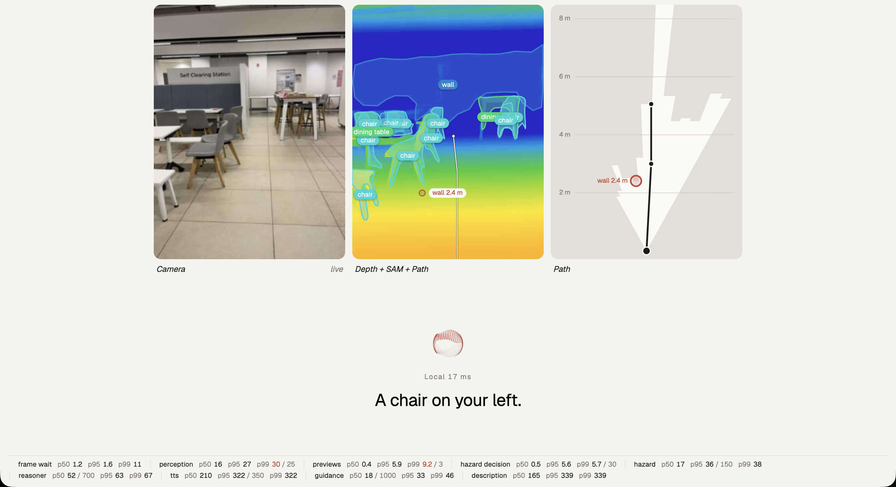
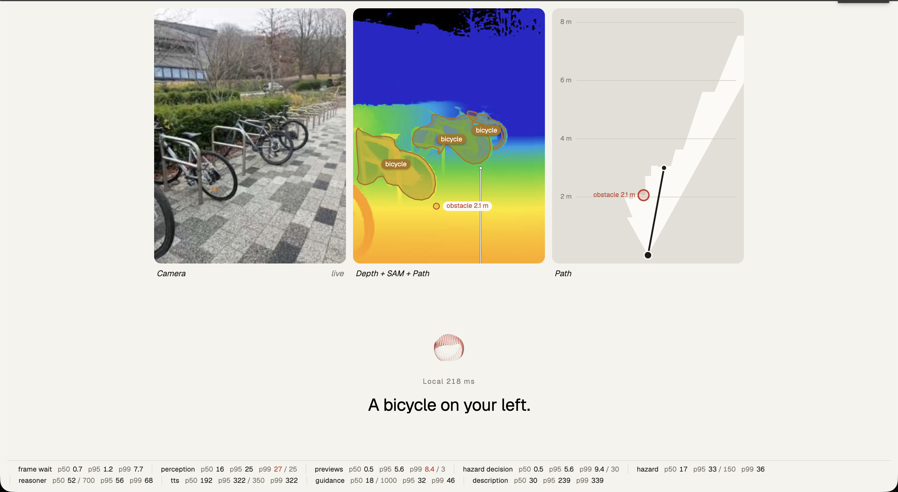
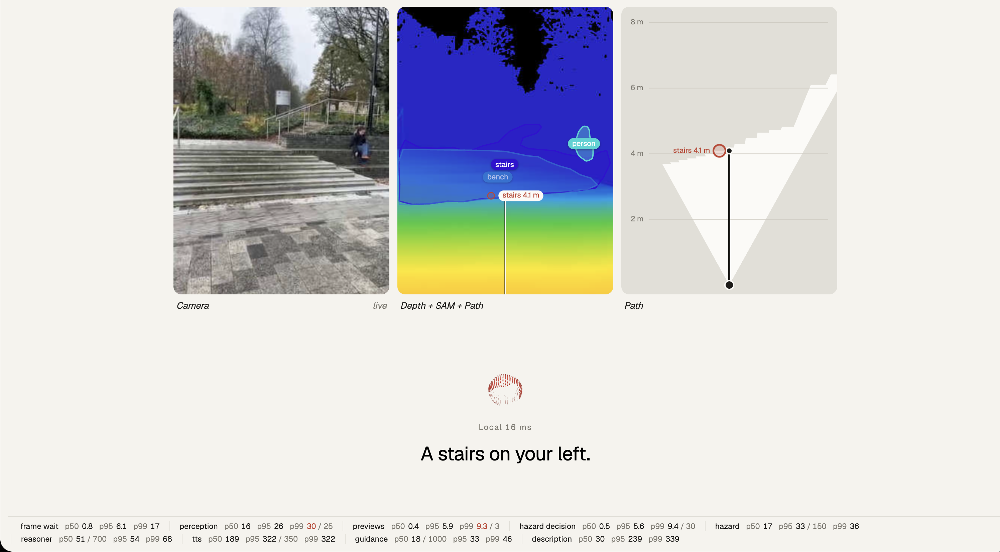
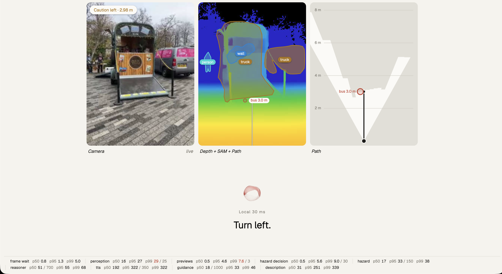
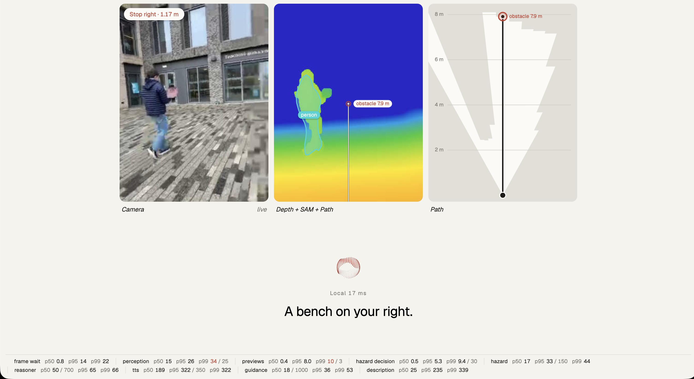
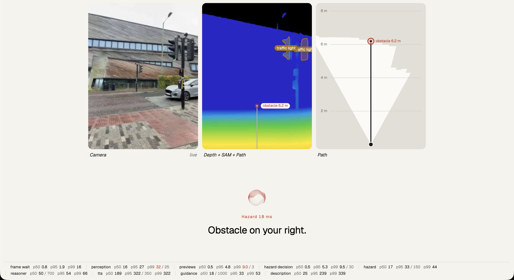
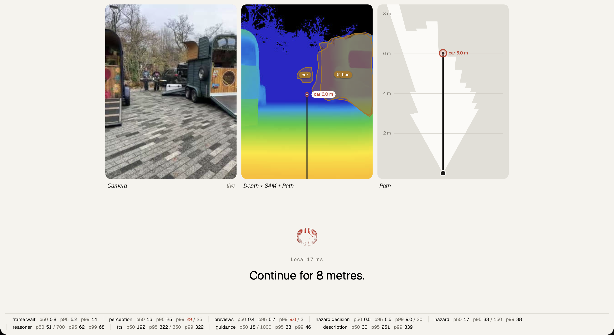

# Sight

Real-time audio navigation assistant for blind and visually impaired people,
built at DurHack 2026. A camera films what is ahead, a depth model on the
local GPU measures how far away everything is, and a voice in the headphones
says what to do: "Keep going straight", "Move a little left", "Stop. Turn
right."



- **Hazard alerts in 16 ms (p50)**, computed on the laptop: "Caution", then
  "Stop", then what is in the way.
- **Directions, not just warnings**: it looks several metres ahead and steers
  only through gaps wide enough for a person.
- **Scene understanding** from Gemini when the scene changes: doorways,
  stairs, road crossings.
- **Keeps working offline**: hazards and local steering never wait on the
  network.

## How it works

```
Camera (30 fps)
      │
      ▼
Perception (local GPU)       Depth Anything 3 Metric-Large → 45 zone
      │                      distances (3 rows × 15 columns), every frame
      ├──────────────────────────────┐
      ▼                              ▼
Hazard tier (local)          Guidance tier
rules on distances →         local steering every frame, plus
cached "Caution" / "Stop"    Gemini → ElevenLabs when the scene changes
      │                              │
      └──────────────┬───────────────┘
                     ▼
              Speech arbiter         hazards interrupt guidance,
                     ▼               stale speech is dropped
                Headphones
```

Two tiers exist because a cloud call cannot meet the 300 ms hazard bound:
imminent obstacles are handled entirely on the laptop, and the cloud is used
only for richer guidance. With the network down, hazard alerts and local
directions keep working.

## The dashboard

A web UI shows what the system sees and why it says what it says:

- **Camera**: the live feed, with the current hazard tag such as
  "Stop right · 1.17 m".
- **Depth + SAM + Path**: metric depth from near (yellow) to far (blue), with
  objects outlined and labelled by RT-DETRv2, SAM 2.1 and DINOv2, and the
  walking line drawn up to the first thing that blocks it.
- **Path**: a top-down view of the free floor in metres, the chosen heading,
  and the nearest obstacle.
- Below: the last instruction, whether it came from the local or hazard tier
  and how long it took, then p50 / p95 / p99 latency for every stage against
  its bound.

| | |
| --- | --- |
|  |  |
| "A bicycle on your left." | "A stairs on your left." |
|  |  |
| "Caution left · 2.98 m", then "Turn left." | "Stop right · 1.17 m" as a person crosses. |
|  |  |
| Hazard tier: "Obstacle on your right." | "Continue for 8 metres." |

## Quick start

Requires [uv](https://docs.astral.sh/uv/) and Python 3.13. No GPU, camera or
API keys are needed for the default preset: every port runs on a fake.

```sh
uv sync
uv run navigator --preset all-fakes --duration-s 3
```

This prints the event stream (geometry, hazards, route, utterances) as JSON
lines.

## Running with a phone (our demo setup)

This is the configuration we use: the phone streams camera frames and plays
spoken directions, while an NVIDIA GPU with CUDA runs depth estimation and
scene labelling on the host. Speech still uses ElevenLabs; Gemini is not needed.

If you do not already have a `.env` file, copy the template:

```sh
cp .env.sample .env
```

Set `ELEVENLABS_API_KEY` and `ELEVENLABS_VOICE_ID` in `.env`; the value
`placeholder` counts as absent. From the repository root, run:

```sh
uv run --all-extras navigator --preset phone \
  --set phone_host=0.0.0.0 \
  --set web_host=0.0.0.0 \
  --adapter scene_reasoner=labeller \
  --set trigger_min_interval_s=0.13 \
  --set trigger_keepalive_s=0.13
```

The phone's browser needs HTTPS to use its camera. Point an HTTPS tunnel at
`http://127.0.0.1:8001` and open the tunnel URL on the phone. The dashboard is
at <http://127.0.0.1:8000> on the host; use a separate tunnel to port 8000 only
if you need to view it remotely. This command listens on all interfaces, and
the dashboard can show live camera frames. Use a trusted network and keep
remote access private.

### Webcam alternative

To use a webcam and play audio on the host instead, also set `GEMINI_API_KEY`
in `.env` and run:

```sh
uv run --all-extras navigator --preset live
```

### Presets and options

| Preset | Camera | Perception | Reasoning | Speech | Audio out | Events |
| --- | --- | --- | --- | --- | --- | --- |
| `all-fakes` | synthetic | scripted wall | scripted | tones | recorded in memory | JSON lines |
| `replay` | recorded session | recorded session | scripted | tones | recorded in memory | JSON lines |
| `live` | webcam | GPU | Gemini | ElevenLabs | sound device | web UI |
| `phone` | phone browser | GPU | Gemini | ElevenLabs | phone speaker | web UI |
| `video` | recorded session | GPU | Gemini | ElevenLabs | `out/speech.wav` | web UI |
| `live-offline` | webcam | GPU | scripted | tones | sound device | web UI |

Options:

- `--adapter port=name` swaps one adapter, and can be repeated. For example
  `--adapter scene_reasoner=labeller` labels the scene with local models and
  no network.
- `--set key=value` overrides any field of `Settings` in
  `src/navigator/bootstrap/config.py`, such as `--set stop_m=1.2`.
- `--duration-s N` stops the run after N seconds.

## Measured latency

RTX 5070 Ti Laptop GPU, recorded walk looped for 150 s, real Gemini and
ElevenLabs, development network. Times run from frame arrival to audio
handed to the sink; sensor and DAC delay are not included.

| Stage | p50 | p95 | p99 | Bound |
| --- | --- | --- | --- | --- |
| Perception | 15.3 ms | 15.9 ms | 16.3 ms | 25 ms p99 |
| Hazard alert, frame to audio | 15.9 ms | 16.4 ms | 22.1 ms | 150 ms p95 |
| Gemini, request to first instruction | 784 ms | 941 ms | 1018 ms | 700 ms p50 |

The Gemini figure is flattering, because the looped walk shows it the same
images repeatedly. Method, caveats and the full table are in
[docs/latency-budget.md](docs/latency-budget.md).

## Tests and benchmarks

```sh
uv run pytest
uv run pytest -m "not gpu and not camera and not keys and not audio_device"
```

The first runs everything, including tests that call the real APIs when keys
are present in `.env`. The second leaves out everything that needs hardware
or keys.

`tests/architecture/` enforces the repository rules: the hexagonal import
rule, every file under 300 lines, and no comments or docstrings in Python.

`bench/` holds the benchmark gates and tools, run as
`uv run python bench/<script>.py`:

| Script | Measures or does |
| --- | --- |
| `env_check.py` | GPU stack imports and camera modes |
| `g1_depth.py`, `g1b_distance.py` | Depth speed and distance accuracy |
| `g2_gemini.py`, `g3_elevenlabs.py` | Cloud first-token and first-audio times |
| `g4_camera.py` | Camera latency |
| `walk_latency.py` | Per-stage latency over a recorded walk |
| `record_session.py` | Records a session into `fixtures/sessions/` from a webcam, phone or video file |
| `render_run.py` | Renders a run to `out/run.mp4` |

## Layout

```
src/navigator/
  domain/        immutable types and pure policies
  ports/         one interface per external capability
  application/   services that move data between ports
  adapters/      one package per technology, with a fake for every port
  bootstrap/     configuration and wiring
tests/           domain, contract, application and architecture suites
bench/           benchmark gates and tools
fixtures/        recorded sessions and sample scenes
docs/            design documents
```

The architecture is hexagonal: dependencies point inward only, and
everything with a vendor name sits behind a port. Swapping a fake for a real
adapter is a configuration change, not a code change.

The web UI bundle in `src/navigator/adapters/ui/static/` is committed. To
rebuild it after changing `src/navigator/adapters/ui/frontend/`:

```sh
cd src/navigator/adapters/ui/frontend
npm install
npm run build
```

## Documentation

| Document | Covers |
| --- | --- |
| [docs/project.md](docs/project.md) | Vision, pipeline, goals, scope; start here |
| [docs/architecture.md](docs/architecture.md) | Ports, services, threads, adapter registry |
| [docs/contracts.md](docs/contracts.md) | Frozen data types and interfaces, and their change protocol |
| [docs/latency-budget.md](docs/latency-budget.md) | Bounds, per-stage budgets, measurements |
| [docs/models.md](docs/models.md) | Depth, reasoning and speech model decisions |
| [docs/optimization.md](docs/optimization.md) | GPU kernels, scheduling, phone and cloud links |
| [docs/plan.md](docs/plan.md) | Work split, directory ownership, milestones |

This is a hackathon proof of concept, not a medical device.
